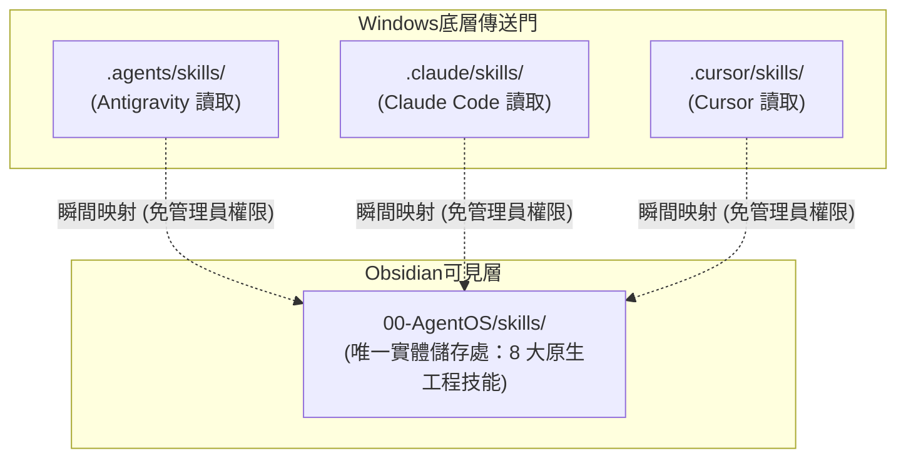

# 🏗️ SecondBrain 系統各部件詳細說明書 (SYSTEM_COMPONENTS.md)

> [!NOTE]
> 本文件深入拆解本知識庫各資料夾、核心設定檔與機制的設計目的，適合需要理解系統底層原理時查閱。

---

## 1. 根目錄核心設定檔與防禦中樞 (Root Directives & Shields)

| 檔案名稱 | 核心角色 | 功能與運作機制說明 |
| :--- | :--- | :--- |
| **`AGENTS.md`** | **全域憲法與唯一事實來源 (SSOT)** | 最高優先級指令檔。所有 AI 工具啟動時強制載入。約束 30 秒 Fast Onboarding、反討好求真、強制主動外檢、精準檢索與 Conventional Commits。 |
| **`CLAUDE.md`** | Claude Code 自動載入指針 | 內嵌 `@AGENTS.md`，使 Anthropic Claude Code 在啟動時將全域憲法直接內嵌進系統提示詞中。 |
| **`GEMINI.md`** | Gemini / Antigravity 指針 | 內嵌 `@AGENTS.md`，使 Gemini 系列模型與 Antigravity 代理人無條件對齊核心規範。 |
| **`.cursorrules`** | Cursor 編輯器指針 | 將 Cursor IDE 深度鎖定至 `AGENTS.md`，遵循專案沙盒與規範。 |
| **`.cursor/rules/`** | Cursor Granular Rules | 存放 `agentos-core.mdc`，確保在 Cursor 內對所有檔案 pattern 均套用核心規範。 |
| **`setup_skills_junctions.bat`** | Windows 傳送門配置腳本 | 批次建立 Windows NTFS Directory Junctions，將 `00-AgentOS/skills` 瞬間映射至各大 AI 工具目錄。 |
| **`.git/hooks/pre-commit`** | Git 本地安全硬約束守門 | 在終端層級自動檢查，若提交包含 `.env`、`__pycache__`、`workspace.json` 或 `scratch/` 則強制拒絕 Commit。 |
| **`README.md`** | 人機導覽牌 | 頂層目錄路標，引導人類前往 `UserGuide/`、引導 AI 前往 `00-AgentOS/`。 |

---

## 2. 核心控制與技能傳送門架構 (Skills & Junction Architecture)

### 為什麼採用 Windows NTFS Directory Junction？
1. **解決 Obsidian 與 AI 工具的衝突**：  
   Obsidian 預設隱藏以「點」開頭的資料夾（如 `.agents`、`.claude`）；但各家 AI 工具卻只會讀取各自隱藏目錄下的 `skills/`。
2. **徹底告別複製地獄**：  
   過去複製兩份檔案會造成不同步。現在**實體檔案只有一份（在 `00-AgentOS/skills/`）**。
3. **即時連動生效**：  
   你在 Obsidian 裡修改任何技能筆記，Antigravity、Claude Code、Cursor 底層立即生效，完全不用重新複製。
4. **原生免管理員權限**：  
   不同於 Windows Symlink 需要開發者模式或管理員權限，NTFS Junction 一般帳號即可直接建立，相容性極高。

### 內建 8 大技能清單：
* `ask-matt`：技能工作流諮詢導航。
* `grill-with-docs`：結合知識庫的蘇格拉底提問需求對齊。
* `to-spec`：收斂產出規格書（SPEC.md）。
* `to-tickets`：拆解為任務卡片（TICKETS.md）。
* `implement`：執行任務開發。
* `tdd`：測試驅動開發（Red-Green-Refactor）。
* `code-review`：標準與規格雙軸度代碼審查。
* `handoff`：上下文交接與狀態同步。

---

## 3. `00-AgentOS/` (AI 規範與術語庫)

* **`AGENT_GUIDE.md`**：專門定義 **AgentOS 8 階標準工作流**（`/grill-with-docs` $\to$ `/to-spec` $\to$ `/to-tickets` $\to$ `/implement` $\to$ `tdd` $\to$ `code-review` $\to$ `commit` $\to$ `handoff`）與**使用者提問模板響應準則（模板 A/B/C）**。
* **`GLOSSARY.md`**：收錄 MCP、RAG、TDD、Active Share、VWAP 等核心專有名詞定義，約束 AI 直接引用、嚴禁長文鋪陳浪費 Token。
* **`workflows/`**：
  * `RECOMMENDED_WORKFLOW.md`：定義標準工程流水線階段細節。
  * `PROJECT_LIFECYCLE.md`：定義專案在活躍 (`_active`) 與歸檔 (`_archive`) 階段的生命週期規範。

---

## 4. `01-Projects/` (專案開發與沙盒)

本系統採 **專案與代碼就地開發（In-place Development）**，並嚴格維持 **核心三檔 + 數據隔離** 架構：

* **`_active/[專案名稱]/`**：
  1. **`CONTEXT.md`**（核心靈魂）：30 秒快速接手檔。記錄當前目標、即時下一步、阻礙與關鍵決策。
  2. **`SPEC.md`**：技術規格書。包含系統架構圖、資料流、API 介面定義。
  3. **`TICKETS.md`**：微型任務卡片清單。
  4. **`src/` & `tests/`**：專案原始碼與自動化測試套件。
  5. **`reports/`**：批量產出物隔離區（如 `<Project>/reports/` 集中歸檔每日報表，絕不回流污染 Areas 長青庫）。
* **`_archive/`**：已結案專案，封存前執行 `/handoff` 產出最終 `SUMMARY.md`。

---

## 5. `02-Areas/` (長青核心領域大腦 - Evergreen Knowledge)

收錄經過時間考驗、跨專案複利的領域知識，可依個人領域自由建立子目錄：

* **`AI-Agent/`**：收錄 Agent 記憶模型、提示詞工程、多代理協作協議與架構指南。
* **`Data-Analysis/`**：資料分析方法論、特徵工程與模型建構指南。
* **`Engineering/`**：通用系統設計、開發實踐與學術理論筆記。

---

## 6. `_inbox/`、`03-Resources/`、`04-Archive/`、`05-Templates/`

* **`_inbox/`**：零阻力靈感收集箱。隨手傾倒想法，AI 定期提煉至 `02-Areas/`。
* **`03-Resources/`**：收錄外部素材，分為 `docs/`、`papers/`、`snippets/`。
* **`04-Archive/`**：歷史專案結案報告與封存資料庫。
* **`05-Templates/`**：
  * `Context_Template.md`：專案進度即時範本。
  * `Project_Template.md`：專案規格（SPEC）範本。
  * `Knowledge_Template.md`：領域原子筆記範本。
  * `Decision_Template.md`：架構決策紀錄（ADR）範本。
