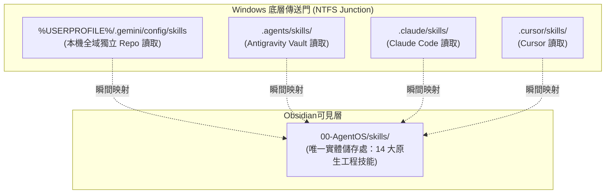

# 🏗️ SecondBrain 系統各部件詳細說明書 (SYSTEM_COMPONENTS.md)

> [!NOTE]
> 本文件拆解 SecondBrain **v3.0（單倉自包含 + 全域 AgentOS 掛載架構）** 的各資料夾、核心設定檔與防禦機制。

---

## 1. 根目錄核心設定檔與防禦中樞 (Root Directives & Shields)

| 檔案名稱 | 核心角色 | 功能與運作機制說明 |
| :--- | :--- | :--- |
| **`AGENTS.md`** | **全域憲法 (v3.0 SSOT)** | 最高優先級指令檔；透過 HardLink 同步至 `~/.gemini/config/AGENTS.md`，使所有獨立 Repo 自動繼承三級分流、反迎合求真、回合級外檢、50/60 行上限與 PR/CI 閉環。 |
| **`CLAUDE.md`** | Claude Code 引用指針 | 內嵌 `@AGENTS.md`，使 Claude Code 啟動時載入全域憲法。 |
| **`.aider.conf.yml`** | Aider 設定檔 | 指定預設讀取 `AGENTS.md`。 |
| **`.windsurfrules`** | Windsurf 指針 | 引導 Windsurf AI 遵循根目錄 `AGENTS.md`。 |
| **`.github/copilot-instructions.md`** | GitHub Copilot 指針 | 引導 Copilot 依單倉 `./AGENTS.md` + `./CONTEXT.md`（及舊版 `_active/` 相容路徑）進行 Fast Onboarding。 |
| **`setup_skills_junctions.bat`** | Windows 一鍵全域掛載腳本 | 設定本地與全域 `core.hooksPath`、UTF-8 路徑與 LF 換行，並建立 `.agents`、`.claude`、`.cursor` 與 `~/.gemini/config/` 的 NTFS Junction / HardLink。 |
| **`DASHBOARD.md` / `PROJECTS_WAR_ROOM.canvas`** | 決策儀表板與空間白板 | 彙整 `_inbox/` 待消化隊列、舊版 `_active/` 專案狀態與 `01-Projects/PROJECTS_REGISTRY.md` 入口。 |
| **`README.md`** | 人機導覽與技能總表 SSOT | 定義跨裝置建置入口與 **14 大現役全域技能清冊**。 |

---

## 2. 核心控制與技能傳送門架構 (Skills & Junction Architecture)

### 為什麼採用 Windows NTFS Directory Junction？
1. **解決 Obsidian 與 AI 工具的衝突**：Obsidian 預設隱藏以 `.` 開頭的目錄，而各 AI 工具需讀取各自 `.*/skills/` 目錄。
2. **單一事實來源**：實體僅存於 `00-AgentOS/skills/`，在 Obsidian 編輯立即對所有工具與獨立 Repo 生效。
3. **免管理員權限**：NTFS Junction 一般使用者帳號即可建立，完整清單請見 [README.md](../README.md)。

---

## 3. `00-AgentOS/` (AI 規範、防線與術語中樞)

* **`AGENT_GUIDE.md`**：定義 L1/L2/L3 工作流三級分流矩陣、8 階標準工程工作流、50/60 行雙上限與模板 A/B/C SOP。
* **`PROFILE.md`**：個人偏好與主題決策矩陣（50/50 岔路平手裁決器，$\le 50$ 行）。
* **`GLOSSARY.md`**：收錄 Agent / AgentOS / MCP / RAG / TDD / Alpha vs. Beta / Sharpe Ratio / MDD / Lookahead Bias / Multi-Factor Model 等核心術語。
* **`hooks/`**：受版控的全域 Git 守門腳本（經 `core.hooksPath` 套用至全機 Repo，並自動串接專案本地 Hooks）：
  * `pre-commit`：攔截 `.env`、`key.json`、`local.properties`、`*.pem`/`*.key`、`id_*`、`credentials.json`、API Key / 私鑰 / DB 帳密樣式、`__pycache__`、非 fixtures 資料大檔與 $>500\text{KB}$ 檔案。
  * `commit-msg`：剝除 AI 水印與 `Co-authored-by` 標籤，強制驗證 Conventional Commits 格式（支援 `feat|fix|docs|refactor|chore|test|ci|build|perf|style|revert` 與 `!` 標記）。
* **`workflows/`**：`RECOMMENDED_WORKFLOW.md`（標準工程流水線）與 `PROJECT_LIFECYCLE.md`（專案兩態生命週期與 Token 控管）。

---

## 4. `01-Projects/` 與外部單倉 `repos/` (專案開發與索引)

* **預設 v3.0 單倉自包含模式 (`<WORKSPACE_ROOT>/repos/<專案>/`)**：程式碼、測試、`.github/workflows/ci.yml` 與治理四件套（`AGENTS.md` $\le 50$ 行、`CONTEXT.md` $\le 60$ 行、`SPEC.md`、`TICKETS.md`）直接同置於單一 Git 倉儲，無須 `.code-workspace`。
* **`01-Projects/PROJECTS_REGISTRY.md`**：輕量登錄總表，提供跨專案總覽索引。
* **`01-Projects/_active/`**：相容保留舊版解耦模式之現役專案（如 `<ProjectName>`），結案後統一歸檔至 `04-Archive/projects/`。

---

## 5. `02-Areas/`、`_inbox/`、`03-Resources/`、`04-Archive/`、`05-Templates/`、`scripts/`

* **`_inbox/`**：零阻力靈感與 Web Clipper 收集箱，透過 `/inbox-digest` 定期提煉並清零。
* **`02-Areas/`**：跨專案可複用之長青領域知識（含 [Software-Architecture 系統架構模式庫](../02-Areas/Software-Architecture/README.md)、`AI-Agent/`、`Data-Analysis/`、`MCP/`、`Coursework/` 等）。
* **`03-Resources/`**：外部參考文件、可複用代碼片段 (`snippets/`) 與 Obsidian 貼圖附件 (`attachments/`)。
* **`04-Archive/`**：全庫唯一歷史封存真源，包含已結案專案治理封存（`projects/`）與參考資料庫。
* **`05-Templates/`**：四件套範本（`Project_AGENTS_Template.md`、`Context_Template.md`、`Project_Template.md`）、`Architecture_Playbook_Template.md`、`Knowledge_Template.md`、`Decision_Template.md`、`Research_Template.md` 與 `WebClipper_Template.md`。
* **`scripts/` & `tests/`**：`audit_vault.py` 與 `test_vault_health.py` 自動稽核行數上限、技能清冊同步、斷裂連結、Frontmatter 與 Hooks 換行格式。
