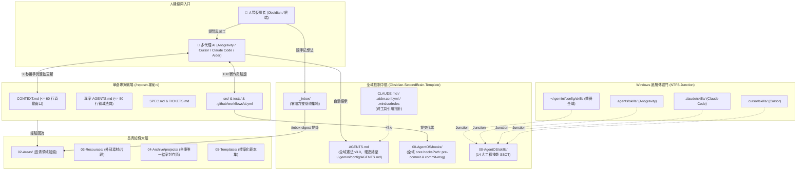

# 📖 SecondBrain 旗艦使用操作手冊 (USER_GUIDE.md)

> [!IMPORTANT]
> **版本狀態**：v3.0（單倉自包含 + 全域 AgentOS 掛載、三級分流與雙層 Git Hook 守門）  
> 本手冊是為**人類工程師/研究者（你）**量身打造的操作藍圖。  
> 🛠️ **開箱安裝與環境設定**：請參閱根目錄 [SETUP.md](../SETUP.md) 與 [SETUP_GUIDE.md](./SETUP_GUIDE.md)。

---

## 🗺️ 系統全貌架構圖 (System Architecture)

本系統融合 **PARA 方法論**、**Matt Pocock 的 Agent 軟體工程工作流**，以及 **單倉自包含 + Windows 全域傳送門架構**：



---

## ⚡ 工作流三級分流機制 (避免過度工程)

* **L1【微型維護】**（`< 30 行` 變更、Typo、文檔微調）：讀專案 `AGENTS.md` $\to$ 實作 $\to$ 本地驗證 $\to$ `commit`。免 SPEC/TICKETS、免 `[GATE]` 標頭。
* **L2【常規功能 / 除錯】**（單一模組功能、Bug 修復、單一 Ticket）：讀 `AGENTS.md` + `TICKETS.md` $\to$ `tdd` $\to$ `implement` $\to$ `commit` $\to$ `/handoff`。
* **L3【新專案 / 跨模組重構】**：觸發顆粒度熔斷，確認拆解後走滿 [AGENT_GUIDE.md](../00-AgentOS/AGENT_GUIDE.md) 標準 **8 階工作流**（`/grill-with-docs` $\to$ `/to-spec` $\to$ `/to-tickets` $\to$ `/tdd` $\to$ `/implement` $\to$ `/code-review` $\to$ `commit` + PR/CI $\to$ `/handoff`）。

---

## 🛑 AI 鋼鐵防禦守則

AI 在本庫與本機所有獨立 Repo 工作時，強制遵守 [AGENTS.md](../AGENTS.md) 核心條款：

1. **反討好與求真**：禁止迎合客套開頭；先檢視反例、邊界風險與 Trade-off，再給技術裁決。
2. **回合級強制外檢**：涉及業界實務、第三方 API 或報錯排查時，第一動作調用 `web-research` 技能，嚴禁憑舊記憶盲猜。
3. **兩次失敗強制熔斷**：連續 2 次修改無法過測即停手輸出根因與卡點報告。
4. **50/60 行雙滾動窗口**：專案 `AGENTS.md` $\le 50$ 行、`CONTEXT.md` $\le 60$ 行（「最近完成事項」僅留最近 3 筆）。
5. **全域 Git 雙守門**：透過全域 `core.hooksPath` 指向 [00-AgentOS/hooks/](../00-AgentOS/hooks/)，攔截機密檔、API Key 樣式、$>500\text{KB}$ 檔案與非 Conventional Commits 格式（並串接專案本地 Hooks）。
6. **自動分支與 PR/CI 閉環**：綁定 GitHub Remote 且具 `.github/workflows/ci.yml` 的專案，L2/L3 自動開功能分支、推送開 PR 並監看 CI（嚴禁自動 Merge）。

---

## 🚀 七大日常實戰情境操作指南

### 情境 1：捕捉靈感與隨手筆記（零阻力輸入）
* 直接在 [_inbox/](../_inbox/README.md) 建立 `.md`（或用 Web Clipper 套用 [WebClipper_Template.md](../05-Templates/WebClipper_Template.md)），定期對 AI 下達 `/inbox-digest` 提煉至 `02-Areas/` 並清空 `_inbox/`。

### 情境 2：開始一個全新專案 (Idea $\rightarrow$ Spec $\rightarrow$ Tickets，L3 工作流)
* 在 `<WORKSPACE_ROOT>/repos/<專案名稱>/` 初始化單倉資料夾並開啟 IDE / `agy` CLI（全域規範與 14 技能自動生效），對 AI 說：
  > 💬 **「我想開啟新專案 `[專案名稱]`，目標是 `[簡述 1~2 句話]`。請調用 `/grill-with-docs` 檢索 Vault `02-Areas/` 既有知識提出 3–5 個關鍵問題；確認後於本專案根目錄執行 `/to-spec` 與 `/to-tickets`。」**
* 若需總覽追蹤，在 Vault 的 [PROJECTS_REGISTRY.md](../01-Projects/PROJECTS_REGISTRY.md) 登記一行索引即可。

### 情境 3：接手做一半的專案（30 秒快速接軌）
* 直接開啟專案資料夾 `repos/<專案名稱>/`（舊版解耦專案則指 `01-Projects/_active/<專案名稱>/`），對 AI 說：
  > 💬 **「請讀取 `AGENTS.md` 與 `CONTEXT.md`。我們現在做到哪？下一步是什麼？」**

### 情境 4：日常寫程式與 TDD 測試驅動開發 (L2 工作流)
* 對 AI 說：
  > 💬 **「請執行 `/implement` 推進 `TICKETS.md` 中的 Ticket-X，嚴格遵守 `tdd`（先紅燈、再綠燈、後重構）。」**

### 情境 5：技術二選一需要架構決策 (ADR)
* 對 AI 說：
  > 💬 **「針對 `[專案名稱]` 的 `[方案A]` vs `[方案B]`，請先以 `web-research` 查證業界最新實務，再依 `05-Templates/Decision_Template.md` 分析 Trade-off 與邊界條件。」**

### 情境 6：專案重要成果「回流」大腦（知識資產複利）
* 對 AI 說：
  > 💬 **「請將剛完成的 `[模組/演算法]` 核心架構與踩坑心法，依 `05-Templates/Knowledge_Template.md` 提煉為長青原子筆記存入 Vault `02-Areas/[領域]/`。」**

### 情境 7：對話太長、收工或結案歸檔
* **收工交接**：輸入 `/handoff`，執行知識升遷、規則固化、50/60 行雙上限校驗並同步更新 `CONTEXT.md`。
* **專案結案封存**：依 [PROJECT_LIFECYCLE.md](../00-AgentOS/workflows/PROJECT_LIFECYCLE.md) 產出 `SUMMARY.md` 並統一歸檔至 `04-Archive/projects/<專案>/`（單一封存真源）。

---

## 🛠️ 原生工程技能快速導覽 (14 Active Skills)

完整 14 大技能清冊、觸發條件與底層依賴請見唯一事實來源：**[README.md](../README.md)**。
常用工作流技能入口：
* **規劃與釐清**：`/ask-matt`、`/grill-with-docs`、`/to-spec`、`/to-tickets`
* **開發與審查**：`/tdd`、`/implement`、`/code-review`、`web-research`
* **維護與收尾**：`/handoff`、`/tech-debt-audit`、`code-simplify`、`dep-clean`、`doc-cleanup`、`inbox-digest`

---

## 🔧 系統自訂與擴充指南

得益於「單一事實來源 (SSOT)」與「Windows Junction / HardLink」架構，在 Obsidian 修改單一位置即全工具同步：

| 規範類型 | 修改檔案位置 | 生效機制 |
| :--- | :--- | :--- |
| **全域底線憲法** | 根目錄 [AGENTS.md](../AGENTS.md) | 經 HardLink 同步至 `~/.gemini/config/AGENTS.md`，本機所有獨立 Repo 即刻生效 |
| **工作流與提問模板** | [00-AgentOS/AGENT_GUIDE.md](../00-AgentOS/AGENT_GUIDE.md) | Agent 執行 L1/L2/L3 與模板 A/B/C 時按需載入 |
| **專案領域法典** | 各專案根目錄 `./AGENTS.md`（$\le 50$ 行） | 單向收緊全域憲法，僅對該專案生效 |
| **全域技能新增/修改** | [00-AgentOS/skills/](../00-AgentOS/skills/)`<skill>/SKILL.md` | 經 NTFS Junction 同步至 `.agents`、`.claude`、`.cursor` 與 `~/.gemini/config/skills`；異動後強制同步更新 [README.md](../README.md) |

---

## 📂 知識庫物理結構一覽

```text
Obsidian-SecondBrain-Template/
├── AGENTS.md                  # 全域憲法 v3.0 (HardLink 至 ~/.gemini/config/AGENTS.md)
├── CLAUDE.md / .aider.conf.yml / .windsurfrules  # 跨工具引用指針
├── setup_skills_junctions.bat # Windows Junction、HardLink 與全域 Git Hooks 一鍵腳本
├── DASHBOARD.md               # Dataview 決策總覽儀表板
├── PROJECTS_WAR_ROOM.canvas   # 現役專案空間白板
├── 00-AgentOS/                # AGENT_GUIDE, GLOSSARY, PROFILE, hooks/, skills/, workflows/
├── 01-Projects/
│   ├── PROJECTS_REGISTRY.md   # v3.0 自包含專案總冊
│   └── _active/               # 舊版解耦現役專案 (待結案後遷出)
├── 02-Areas/                  # 長青領域大腦 (AI-Agent, Data-Analysis, MCP, Coursework...)
├── 03-Resources/              # 外部素材、snippets、attachments
├── 04-Archive/                # 全庫唯一歷史封存區 (projects/ 與參考資料庫)
├── 05-Templates/              # 標準化四件套、ADR、知識與 WebClipper 範本
├── UserGuide/                 # 人類操作手冊區
├── _inbox/                    # 零阻力靈感收集箱
├── scripts/ & tests/          # Vault 健康檢查腳本與自動化測試
└── repos/ (位於同層外置目錄)  # <WORKSPACE_ROOT>/repos/<專案>/ 單倉自包含開發區
```
