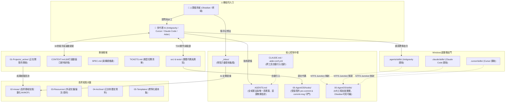

# 📖 SecondBrain 旗艦使用操作手冊 (USER_GUIDE.md)

> [!IMPORTANT]
> **版本狀態**：v2.2（工業級三級分流、滾動窗口與 Git Hook 守門實體化）  
> 本手冊是為**人類工程師/研究者（你）**量身打造的操作藍圖。日常無論是寫程式、讀論文、記靈感或與 AI 對話，依循本手冊之情境與提問模板即可發揮本系統最大威力。  
> 🛠️ **初次使用或新電腦開箱設定**：請參閱 [[SETUP_GUIDE|SETUP_GUIDE.md]]。

---

## 🗺️ 系統全貌架構圖 (System Architecture)

本系統融合了 **PARA 方法論**、**Matt Pocock 的 Agent 軟體工程工作流**，以及支援 **跨 IDE（Antigravity、Cursor、Claude Code、Aider）的單一真理源與 Windows 底層傳送門架構**：



---

## ⚡ 工作流三級分流機制 (避免過度工程)

為防止小修補強套完整流程帶來的摩擦力，AI 必須根據任務大小自動分流：

* **L1【微型維護 / 快速修復】(< 30 行變動、數值微調、單純 Typo)**：  
  `implement` $\to$ 本地可執行驗證 $\to$ 規範化 `commit`。無需撰寫 SPEC 或 TICKETS，極速推進。
* **L2【常規功能 / 單一模組】(新增功能、明確的 Bug 修復、單一 Ticket 推進)**：  
  檢閱 `TICKETS.md` $\to$ 遵循 `tdd/implement` $\to$ 規範化 `commit` $\to$ 快速 `/handoff` 同步狀態。
* **L3【新專案啟動 / 重大重構】(全新專案、整體架構改動、核心算法選型)**：  
  強制走滿標準 8 階工作流（`grill` $\to$ `spec` $\to$ `tickets` $\to$ `implement` $\to$ `tdd` $\to$ `code-review` $\to$ `commit` $\to$ `handoff`）。

---

## 🛑 AI 鋼鐵防禦守則 (你賦予 AI 的核心原則)

AI 在本庫工作時，必須強制遵守 [AGENTS.md](../AGENTS.md) 的核心防禦條款：

1. **反討好與求真 (Anti-Sycophancy & Truth-First)**：  
   AI 嚴禁盲目迎合你的假設。若架構決策或代碼存在邏輯缺陷，必須以客觀技術證據（邊界條件、Trade-off、效能）直球指出。
2. **外部事實校準與主動外檢 (Fact-First Protocol)**：  
   遇到第三方套件語法、業界規範或報錯排除時，AI 必須在思考第一步**主動調用當前環境的聯網搜尋工具**，嚴禁憑舊記憶盲猜。
3. **精準檢索與拒絕全庫傾倒 (Semantic Search & Grep)**：  
   AI 在查找你的知識庫時，使用精確關鍵字（grep/ripgrep）或語意向量（MCP 工具），每次只讀取最相關的 2~3 篇筆記，嚴禁全庫傾倒。
4. **兩次失敗強制熔斷 (Fail-Fast Circuit Breaker)**：  
   連續 2 次修改代碼測試未過，AI 必須立即停手說明卡點，嚴防陷入盲試循環（Doom Loop）燒光額度。
5. **CONTEXT.md 60 行滾動上限 (Rolling Window)**：  
   專案 `CONTEXT.md` 嚴格限制在 60 行內，「已完成事項」只保留最近 3 筆，更早的進度交給 Git Log，杜絕膨脹為 Token 黑洞。
6. **Git 本地硬約束雙守門 (Pre-Commit & Commit-Msg Hooks)**：  
   受版控於 `00-AgentOS/hooks/`：
   * `pre-commit`：自動攔截 `.env`、`__pycache__`、`workspace.json` 或 `scratch/`。
   * `commit-msg`：自動剝除 AI 水印標籤，並強制校驗 `<type>(<scope>): <subject>` 格式。

---

## 🚀 七大日常實戰情境操作指南

### 情境 1：捕捉靈感與隨手筆記（零摩擦輸入）
* **做法**：看到好文章或靈感，直接在 [_inbox/](../_inbox/) 建立空白 `.md` 貼上。定期對 AI 說：
  > 💬 **「請檢視 `_inbox/` 裡的草稿，幫我將有價值的通用經驗提煉為原子筆記存入 `02-Areas/`，整理後清空 Inbox。」**

---

### 情境 2：開始一個全新專案 (Idea $\rightarrow$ Spec $\rightarrow$ Tickets，L3 工作流)
* **做法**：在 `01-Projects/_active/` 底下建立新目錄後，對 AI 複製**模板 A**：
  > 💬 **「我想在 `01-Projects/_active/` 開一個新專案：`[專案名稱]`，目標是 `[簡述 1~2 句話]`。  
  > 請調用 `/grill-with-docs` 檢索 `02-Areas/` 的既有知識，提出 3~5 個關鍵架構問題挑戰我；確認後依序產出 `SPEC.md` 與 `TICKETS.md`。」**

---

### 情境 3：接手做一半的專案（30 秒快速接軌）
* **做法**：直接對 AI 複製**模板 B**：
  > 💬 **「請讀取 `01-Projects/_active/[專案名稱]/CONTEXT.md`。我們現在做到哪？下一步是什麼？」**
* **成果**：AI 僅讀取 40~50 行狀態檔（不到 400 Tokens），1 秒內無縫接手開發。

---

### 情境 4：日常寫程式與 TDD 測試驅動開發 (L2 工作流)
* **做法**：對 AI 說：
  > 💬 **「請依照 `TICKETS.md` 中的 Ticket-X 進行開發。強制遵循 `tdd` 原則：先設計會失敗的單元測試，再寫最低限度實作使測試通過，最後重構。」**

---

### 情境 5：技術二選一需要架構決策 (ADR)
* **做法**：對 AI 說：
  > 💬 **「針對 `[專案名稱]`，我們在 `[方案A]` 與 `[方案B]` 之間猶豫。請依據 `05-Templates/Decision_Template.md` 分析優缺點、邊界條件與 Trade-off，寫成 ADR 草稿。」**

---

### 情境 6：專案重要成果「回流」大腦（知識資產複利）
* **做法**：當你完成了一個厲害模組時，對 AI 說：
  > 💬 **「我們剛剛在 `[專案名稱]` 完成的 `[模組/演算法]` 非常漂亮。請幫我提煉核心架構與心法，寫成一篇長青原子筆記存到 `02-Areas/[領域]/`。」**

---

### 情境 7：對話太長或收工關機（上下文交接）
* **做法**：輸入 `/handoff`：
  > 💬 **「請執行 `/handoff`，更新專案的 `CONTEXT.md`（維持 60 行內，僅留最近 3 筆已完成事項與明確下一步），並幫我壓縮對話。」**

---

## 🛠️ 原生工程技能調用手冊 (Native Skills Reference)

本系統將技能實體唯一保存在 [00-AgentOS/skills/](../00-AgentOS/skills/)（你在 Obsidian 中可直接瀏覽與修改），並透過 Windows Junction 自動映射至 `.agents/skills`、`.claude/skills` 與 `.cursor/skills`：

| 斜線指令 | 功能說明 | 適用等級 |
| :--- | :--- | :--- |
| **`/ask-matt`** | 技能工作流諮詢與推薦導航。 | 隨時可用 |
| **`/grill-with-docs`** | 結合 Areas 筆記進行**蘇格拉底式提問**抓出盲點。 | L3 新專案/架構重構 |
| **`/to-spec`** | 討論收斂後，產出標準技術規格書 **`SPEC.md`**。 | L3 新專案 |
| **`/to-tickets`** | 將規格拆解為按依賴順序排列的微型任務清單 **`TICKETS.md`**。 | L2 / L3 任務規劃 |
| **`/implement`** | 針對特定任務卡片開始進行專注開發。 | L1 / L2 / L3 開發實作 |
| **`tdd`** | 強制 **先寫失敗測試 $\rightarrow$ 實作代碼 $\rightarrow$ 重構通過**。 | L2 / L3 代碼品質保證 |
| **`/code-review`** | 程式碼修改後，進行規格與品質的雙軸度嚴格代碼審查。 | L2 / L3 提交前審查 |

---

## 🔧 系統自訂與擴充指南 (如何修改規範與新增 Skill)

得益於「單一事實來源 (SSOT)」與「Windows Junction 傳送門」架構，您在日常使用中**如果要修改規範或新增 AI Skill，只需在 Obsidian 裡修改單一位置，所有 AI 編輯器 0 秒自動同步**！

### 1. 如何修改系統規範？（按層級修改）

請依據規範的層級，在 Obsidian 中打開對應檔案直接編輯：

| 規範類型                        | 修改檔案位置                                                                                                                  | 涵蓋重點範例                                                                                      | 生效機制                                                                                         |
| :-------------------------- | :---------------------------------------------------------------------------------------------------------------------- | :------------------------------------------------------------------------------------------ | :------------------------------------------------------------------------------------------- |
| **全域底線憲法**<br/>(所有專案/AI 必守) | 根目錄 [**`AGENTS.md`**](../AGENTS.md) | • 反討好求真原則<br/>• 主動外檢觸發條件<br/>• L1/L2/L3 工作流分級<br/>• CONTEXT.md 60 行滾動上限<br/>• Git 提交格式與守門標準 | **存檔即刻生效**！<br/>Antigravity、Cursor、Claude Code（經 `CLAUDE.md` 自動引用）、Aider 全數直讀，**無需修改第二個檔案**。 |
| **工作流與提問模板**<br/>(操作 SOP)   | [**`00-AgentOS/AGENT_GUIDE.md`**](../00-AgentOS/AGENT_GUIDE.md) | • 8 階工作流細節（grill $\to$ spec...）<br/>• 模板 A/B/C 的回應 SOP<br/>• 專案封存與移轉流程                      | 當你輸入模板提問或要求跑工作流時，AI 會按需動態讀取最新版本。                                                             |
| **專案自訂特殊規則**<br/>(僅限特定專案生效) | 各專案目錄下的<br/>`01-Projects/_active/[專案]/CONTEXT.md` | • 專案特定的雙模型協作規範<br/>• 專案特定的驗證與領域規範 | 寫在該專案的 `CONTEXT.md` 即可，**專案沙盒會自動隔離**，完全不干擾其他專案。 |

---

### 2. 如何新增或修改 Skill？（3 步驟完成）

因為有 Windows NTFS Junction 傳送門，您**再也不需要手動複製貼上到多個隱藏資料夾**！

#### 🔹 新增 Skill 3 步驟：
1. **在 Obsidian 新增資料夾**：  
   在 [00-AgentOS/skills/](../00-AgentOS/skills/) 底下建立新資料夾，命名為技能代號（建議全小寫加連字號，例：`my-analysis`）。
2. **建立 `SKILL.md` 檔案**：  
   在該資料夾下建立一個檔名固定為 **`SKILL.md`** 的 Markdown 筆記。
3. **填入內容（最關鍵：上方 YAML Frontmatter）**：  
   AI 是靠頂層的 `name` 與 `description` 來決定何時主動調用或推薦技能的：
   ```markdown
   ---
   name: my-analysis
   description: 當需要對專案進行多因子量化評估或回測分析時觸發此技能。
   ---

   # 🛠️ 技能名稱：多因子量化分析

   ## 觸發時機
   當使用者輸入 `/my-analysis` 或詢問因子績效時啟用。

   ## 執行步驟
   1. 檢視當前持倉與因子矩陣。
   2. 計算 IC 值與換手率。
   3. 輸出簡要分析報告，並提醒遵循風控標準。
   ```

#### 🔹 修改既有 Skill：
直接在 Obsidian 打開 `00-AgentOS/skills/[技能名稱]/SKILL.md` 編輯儲存。

#### ✨ 即時同步效果：
存檔的**同一瞬間**，Antigravity (`.agents/skills`)、Claude Code (`.claude/skills`)、Cursor (`.cursor/skills`) 透過底層傳送門**零延遲同時感知**，立刻能在對話框輸入 `/my-analysis` 執行！

---

### 3. 修改後的 Git 提交標準作業

修改規範或技能後，在終端機提交：
```powershell
# 1. 精確指定檔案 (嚴禁 git add .)
git add AGENTS.md 00-AgentOS/skills/my-analysis/SKILL.md

# 2. 規範化提交 (commit-msg 與 pre-commit 會自動過濾 AI 水印並驗證格式)
git commit -m "feat(skill): 新增 my-analysis 量化分析技能"
```

---

## 📂 專案目錄物理結構一覽

```text
Obsidian-SecondBrain-Template/
├── AGENTS.md                  # 🌟 全域憲法與唯一真理源 (直讀無需指針)
├── CLAUDE.md / .aider.conf.yml# 🔗 跨工具自動引入指針
├── setup_skills_junctions.bat # ⚡ Windows 環境與傳送門一鍵配置腳本
├── .gitattributes             # ⚙️ 強制 hooks 與腳本維持 LF 換行
├── 00-AgentOS/
│   ├── AGENT_GUIDE.md         # 📘 L1/L2/L3 工作流矩陣與提問模板 SOP
│   ├── GLOSSARY.md            # 📚 共享術語庫 (避免 AI 重複解釋浪費 Token)
│   ├── hooks/                 # 🛡️ 受版控的 Git 守門腳本 (pre-commit & commit-msg)
│   └── skills/                # 🛠️ 8 大工程技能唯一實體來源 (Obsidian 可見可編)
├── .agents/skills/            # 🪟 Windows Junction 傳送門 (指向 00-AgentOS/skills，供 Antigravity)
├── .claude/skills/            # 🪟 Windows Junction 傳送門 (指向 00-AgentOS/skills，供 Claude Code)
├── .cursor/skills/            # 🪟 Windows Junction 傳送門 (指向 00-AgentOS/skills，供 Cursor)
├── _inbox/                    # 📥 零阻力靈感收集箱 (隨手扔想法，AI定期消化)
├── UserGuide/                 # 📖 人類手冊區 (USER_GUIDE.md, SETUP_GUIDE.md, SYSTEM_COMPONENTS.md)
├── 01-Projects/
│   ├── _active/               # 🚀 進行中專案 (內含 CONTEXT.md、SPEC.md、TICKETS.md)
│   └── _archive/              # 📦 結案封存專案 (內含 SUMMARY.md)
├── 02-Areas/                  # 💡 長青領域大腦 (量化金融、AI-Agent、數位通訊等知識資產)
├── 03-Resources/              # 📚 外部資料庫 (docs, papers, snippets)
├── 04-Archive/                # 🗄️ 過期歷史筆記
└── 05-Templates/              # 📝 標準化筆記與 ADR 範本集
```
